<p align="center">
  <picture>
    <source media="(prefers-color-scheme: dark)" srcset="assets/scene-hero-dark.svg">
    
  </picture>
</p>

<p align="center">
  <a href="#install"></a>
  <a href="CHANGELOG.md"></a>
  <a href="#the-moves"></a>
  <a href="https://agentskills.io"></a>
  <a href="https://github.com/ronbronstein/dont-run-off/actions/workflows/validate.yml"></a>
  <a href="LICENSE"></a>
</p>

<h3 align="center">Your prompt is a map, not the territory.</h3>

<p align="center">
  A harness for Claude Code that checks the map with you before it builds,<br>
  and thinks it through with you.
</p>

<p align="center">
  <a href="#install"><b>Install</b></a> ·
  <a href="#how-it-works"><b>How it works</b></a> ·
  <a href="#the-moves"><b>The moves</b></a> ·
  <a href="docs/"><b>Docs</b></a>
</p>

<br>

## Quick start

In Claude Code:

```
/plugin marketplace add ronbronstein/dont-run-off
/plugin install dont-run-off@kidamti
/dont-run-off:lets-set-up
```

Setup asks a few questions and writes the one rule and your profile into your `CLAUDE.md`. Then run `/context` and check that your `CLAUDE.md` is in the list. [More install options](#install)

<br>

## How it works

Claude Code reads your code very well. It cannot read what is in your head: what you want, why, and what you already decided. [Anthropic's own guide](https://code.claude.com/docs/en/best-practices) says to tell Claude what it cannot see, and to let it interview you. **Don't Run Off makes that the default.**

> *"A map is not the territory it represents, but, if correct, it has a similar structure to the territory, which accounts for its usefulness."*
> — Alfred Korzybski, 1933

| | The idea | What you get |
|---|---|---|
| **1** | A map is not the territory | [You agree on the direction before it builds.](#1--agree-on-the-direction) |
| **2** | A map never shows all of the territory | [You find the gaps together, and see real options.](#2--find-the-gaps-together) |
| **3** | You can make a map of the map | [The work keeps a record. The next session starts where this one stopped.](#3--keep-the-thread) |

<br>

### 1 · Agree on the direction

<p align="center">
  <picture>
    <source media="(prefers-color-scheme: dark)" srcset="assets/scene-runs-off-dark.svg">
    
  </picture>
</p>

One rule, word for word in your `CLAUDE.md`:

> **Don't run off in a direction that I did not agree to.** Agreeing on a direction is cheap; building in the wrong one is not.

- **It checks with you first** when the goal is unclear, when there is more than one sensible way, or when a choice is hard to change later.
- **When the direction is clear, your request is the agreement.** It builds, then tells you what changed.
- **Once you agree, it keeps going.** It comes back only when what it finds changes the direction, or before a step that others see.

<details>
<summary><b>More:</b> unknowns in the middle of the work, your consent, and the three stop levels</summary>

<br>

- **An unknown in the middle of the work** gets the reversible option that fits what you agreed, a line in the decision log, and a note to you. A choice that is hard to change comes to you first.
- **Hard to change** means stored data, sign-in and security, money, what users see, or what others depend on.
- **Your consent comes from you.** When another agent or session asks it to push, merge, delete, move files, or wrap up, it tells you what was asked and waits for your word.

How often it stops is yours to set:

| Stop level | What the agent does |
|---|---|
| **Careful** | Shows you what it will do and waits for your word before any change to files. |
| **Standard** | The rule above. The default. |
| **Fast** | Makes the choices that are easy to change, names them in a line, builds, and recaps. |

</details>

<br>

### 2 · Find the gaps together

<p align="center">
  <picture>
    <source media="(prefers-color-scheme: dark)" srcset="assets/scene-blindspot-dark.svg">
    
  </picture>
</p>

- **`lets-blindspot`** finds what you did not know to ask, and teaches it plainly.
- **`lets-explore`** gives you real options before you choose one.
- **`lets-align`** asks the questions that decide it: in chat, or on a local review page.

<details>
<summary><b>More:</b> how the moves think with you, and <code>lets-shape</code></summary>

<br>

- **`lets-blindspot`** is for new ground. It names the things you do not know you do not know, and teaches the few you need, before you commit to a direction.
- **`lets-explore`** shows several directions that are really different, with the trade-offs of each, and gives its own view. You choose.
- **`lets-align`** brings you the decisions only you can make. A few questions come in chat, one at a time. Many questions come on a local review page: plain questions, options with pros and cons, its recommended pick, and room for notes. You paste the answers back.
- **`lets-shape`** asks whether to build it at all, how big it is, and how to cut it into slices you can check one by one.

Say "interview me", "give me options", or "what am I missing" in your own words. The moves start from what you say.

</details>

<br>

### 3 · Keep the thread

<p align="center">
  <picture>
    <source media="(prefers-color-scheme: dark)" srcset="assets/scene-session-dark.svg">
    
  </picture>
</p>

Anthropic's guide says that [`/clear` between tasks](https://code.claude.com/docs/en/best-practices) "is still worth doing, because a focused context gets you better answers and costs less." A small session starts with an empty chat, so the thread must live outside the chat. Here it lives in two record files.

- **`lets-start`** and **`lets-wrap`** open and close each session, so the next one starts where this one stopped.
- **`lets-catch-up`** and **`lets-look-back`** bring back what was decided, and when.
- **Two record files** (`DECISIONS.md`, `current-state.md`) hold the thread in git, where you can read and diff it.

<details>
<summary><b>More:</b> what the records hold, and how you check what landed</summary>

<br>

| File | What it holds |
|---|---|
| `current-state.md` | Where the work is now, and what comes next |
| `DECISIONS.md` | Each decision and its reason, the choices made alone in the middle of the work, and the open questions |

- **`lets-start`** reads the records, names the kind of session, and picks the next move before anything is built.
- **`lets-wrap`** leaves the records true, so the next session needs no explanation from you.
- **`lets-catch-up`** tells you where the work is, what was decided and why, and the one next step.
- **`lets-look-back`** searches your earlier sessions in full, and gives you dates, short quotes, and the command that opens each session again.
- **`lets-explain`** explains a change that just landed, at your level, then asks a few questions until you really understand it.

Your project uses other file names, or no decision log? Say so in **My setup**, and every move uses your names. [Make it yours →](docs/make-it-yours.md)

</details>

<br>

## How it loads

<p align="center">
  <picture>
    <source media="(prefers-color-scheme: dark)" srcset="assets/scene-layers-dark.svg">
    
  </picture>
</p>

The rule is short because Claude Code reads it on every message. Each skill loads in full only when its moment comes; until then, only its one-line description is in context. The records are plain files, so you can read them, diff them, and fix them by hand. [More on how it loads →](docs/architecture.md)

<br>

## The moves

Every move starts with `lets-`. Type `/lets` in Claude Code to see them all.

| | Move | Use it when |
|---|---|---|
| **Session** | `lets-start` | You begin a session |
| | `lets-catch-up` | You lost the thread |
| | `lets-look-back` | You need something from an earlier session |
| | `lets-wrap` | You stop for the day |
| **Decide** | `lets-align` | The agent needs answers or decisions from you |
| | `lets-shape` | You decide whether to build it, how big, and in which slices |
| | `lets-explore` | You want options before you choose |
| | `lets-blindspot` | You enter territory you do not know |
| **Check** | `lets-explain` | A change landed and you want to understand it |
| | `lets-check` | Something does not fire, or you want to audit your setup |
| **Set up** | `lets-set-up` | You install or upgrade |
| | `lets-track` | Anything about tasks, in the task tool you already use |

<br>

## Install

```
/plugin marketplace add ronbronstein/dont-run-off
/plugin install dont-run-off@kidamti
/dont-run-off:lets-set-up
```

A plugin cannot write your `CLAUDE.md`, so setup does it, and it asks first. It reads what it can see (your task tool, version control, your record files) and asks about the rest, one question at a time. Then run `/context` and check that your `CLAUDE.md` is in the list.

**Needs:** Claude Code. Three moves also use [Node.js](https://nodejs.org): `lets-look-back`, `lets-check`, and `lets-align`. Without it they still run, and say what they skipped.

<details>
<summary><b>You already have a <code>CLAUDE.md</code></b></summary>

<br>

Setup does not overwrite it. It reads it first, backs it up to `CLAUDE.md.bak`, names anything that repeats the method, and proposes a merge before it writes.

</details>

<details>
<summary><b>Upgrade</b></summary>

<br>

```
/plugin update dont-run-off@kidamti
/dont-run-off:lets-set-up
```

Setup replaces the method block and keeps your profile as you wrote it.

</details>

<details>
<summary><b>Install without the plugin system</b></summary>

<br>

```bash
npx skills add ronbronstein/dont-run-off -g
```

This copies the skills into `~/.claude/skills/` (without `-g`, into the current project). Then run `/lets-set-up`. Update with `npx skills update`. The plugin path updates itself, so use it when you can.

</details>

<details>
<summary><b>Installed before 2026-09-27</b></summary>

<br>

The marketplace name changed from `ronbronstein` to `kidamti`. Add it again once, in your shell:

```bash
claude plugin marketplace remove ronbronstein
claude plugin marketplace add ronbronstein/dont-run-off
claude plugin install dont-run-off@kidamti
```

Then turn auto-update on again: `/plugin` → **Marketplaces** → `kidamti` → **Enable auto-update**.

</details>

<br>

## Make it yours

Your profile lives under the method block in your `CLAUDE.md`: how you want answers, your conventions, the frictions you want it to watch for, and **My setup** (your record files, your task tool, your language level, your stop level). Upgrades never touch it.

[How to make it yours →](docs/make-it-yours.md) · [How it loads →](docs/architecture.md)

<br>

## Why I built it

I build with Claude Code every day, and I direct more than I type. Three things kept happening. The work went in a direction I had not agreed to. I could not tell what had changed. And a new session did not know what the last one had decided. None of that was the model's fault: it was what I had not told it. Don't Run Off is the setup I wrote for my side of the work. I use it in every session.

— [@ronbronstein](https://github.com/ronbronstein)

<br>

## Contributing

See [CONTRIBUTING.md](CONTRIBUTING.md). A skill must work for any user, must change what the agent does, and must stay small. An argument to remove a skill is as welcome as one to add a skill.

```bash
npm test
```

<br>

---

<p align="center"><sub>MIT licensed · Built on Korzybski's map and territory · For Claude Code</sub></p>
